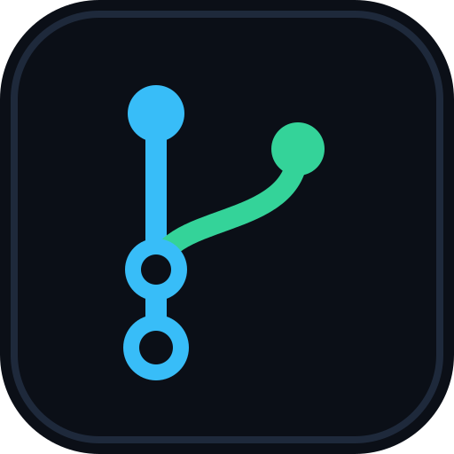

# Chronicle

<p align="center">
  
</p>

<p align="center">
  <strong>A zero-login, local-first Git-style knowledge workspace running entirely in the browser engine.</strong>
</p>

<p align="center">
  <a href="#architecture">Architecture</a> •
  <a href="#distributed-systems-primitives">Core Primitives</a> •
  <a href="#git-semantics--dag-engine">Git Semantics</a> •
  <a href="#benchmarks">Benchmarks</a> •
  <a href="#tradeoffs--failure-modes">Failure Modes</a> •
  <a href="#quick-start">Quick Start</a>
</p>

---

Chronicle brings **two distributed systems primitives** together client-side to solve the core dilemma of local-first note-taking: **collaborative real-time editing** versus **immutable, verifiable version control**.

1. **Live Working Tree:** `Yjs` CRDT + `y-indexeddb` persistence + `BroadcastChannel` for peer-to-peer sibling tab convergence with zero server roundtrips.
2. **Immutable History:** A browser-native SHA-256 **Content-Addressable Storage (CAS)** and **Merkle-DAG** engine in IndexedDB implementing real Git mechanics (blobs, trees, commits, branches, Myers line diffs, and bidirectional-BFS Lowest Common Ancestor 3-way merges).

No cloud servers. No background analytics. No accounts. 100% offline-capable PWA.

---

## Why Chronicle? (The "Not Just Another Text Editor" Thesis)

| Capability | Standard Web Editors / Notion | Local Markdown / Obsidian | Chronicle |
| :--- | :--- | :--- | :--- |
| **Storage Model** | Mutable remote database | File system on disk | Content-Addressable Storage (CAS) in IndexedDB |
| **History Model** | Coarse snapshot history / server logs | External git CLI or paid sync | Native cryptographic Merkle-DAG in browser |
| **Multi-Tab Sync** | Server WebSockets / Polling | None (file watcher race conditions) | Zero-latency `BroadcastChannel` CRDT state vectors |
| **Conflict Handling** | Silent Last-Write-Wins overwrites | Git merge conflicts in terminal | Line-level 3-way LCA merge + in-app conflict resolver |
| **Search Engine** | Naive substring match | File grepping | Incremental inverted index + prefix B-tree cursors |
| **Setup & Dependencies** | Account creation / Login | Node / Git CLI / Local folders | Zero login, zero installation, works in any browser |

---

## Architecture

Chronicle enforces a strict **Pure Core Isolation** architecture: `src/core/` has **zero DOM or React imports**, allowing the entire distributed engine (CAS, VCS, CRDT, search, archive) to execute deterministically in Node.js test harnesses and web workers alike.

```mermaid
flowchart TB
    subgraph UI["Workspace UI (React 19 + CodeMirror 6 + Tailwind CSS)"]
        Editor["MarkdownEditor\n(CodeMirror ↔ Y.Text)"]
        Diff["DiffViewer\n(Unified diff & 3-way resolver)"]
        Sidebar["SidebarTree\n(File tree + status badges)"]
        Top["TopBar\n(Branching, Commit, Merge, Reset)"]
        Palette["CommandPalette\n(⌘K Quick Actions)"]
        SearchModal["SearchModal\n(Full-text inverted search)"]
        XRay["XRayDrawer\n(CAS telemetry & DAG visualizer)"]
        Modals["Workspace & Backup Modals\n(Notebooks, ZIP & JSON archives)"]
    end

    subgraph State["Zustand Reactive Store (src/state/workspace.ts)"]
        Store["WorkspaceState\n(refs, branches, diffs, working files,\ntelemetry, latency history, storage quota)"]
        Actions["Store Actions\n(commit, checkout, merge, search,\nswitchWorkspace, exportArchive, importFiles)"]
    end

    subgraph Core["src/core/ — Pure TypeScript Engine (Zero React/DOM)"]
        Repo["Repository\n(init, status, commit, branch,\ncheckout, deleteBranch, merge, abort)"]
        CAS["IndexedDBObjectStorage\n(Write-once SHA-256 CAS)"]
        Hash["canonicalStringify + Web Crypto SHA-256\n(Deterministic JSON serialization)"]
        DAG["findLCA + getCommitHistory\n(Bidirectional BFS LCA)"]
        DiffCore["diffFileMaps + diffTrees\n(Myers line diff)"]
        Merge["threeWayMerge + conflictParser\n(Diff3 line merge + conflict markers)"]
        Tree["WorkingTreeDoc\n(Y.Map<Y.Text> + y-indexeddb)"]
        Bridge["TabSyncBridge\n(BroadcastChannel protocol)"]
        Undo["FileUndoManager\n(Per-file Y.UndoManager isolation)"]
        SearchIdx["RepositorySearchEngine\n(Inverted index + BM25 scoring)"]
        Archive["repoArchive\n(Deterministic .zip / .json DAG bundles)"]
        Registry["WorkspaceRegistry\n(Isolated DB namespaces & author config)"]
    end

    Editor -->|"Y.Text edits"| Tree
    Editor -->|"keymap"| Undo
    Tree -.->|"checkout transaction"| Bridge
    Bridge -.->|"BroadcastChannel sync"| Tree
    Tree -.->|"persistence"| CAS
    Actions --> Repo
    Repo --> CAS
    Repo --> Tree
    Repo --> DAG
    Repo --> Merge
    Merge --> DiffCore
    Actions --> SearchIdx
    SearchIdx --> CAS
    Actions --> Archive
    Archive --> CAS
    Store --> Actions
    XRay --> CAS
    XRay --> DAG
```



### End-to-End Data Pipeline

```
User Keystroke
     │
     ▼
CodeMirror 6 (local) ────► Y.Text (origin: "local")
     │                            │
     │                            ▼
     │                    FileUndoManager (tracks only "local" edits)
     │                            │
     ▼                            ▼
WorkingTreeDoc.setFile()  ◄───────┘
     │
     ▼
TabSyncBridge ◄──── Y.encodeStateAsUpdate()
     │
     ├──► BroadcastChannel("chronicle-crdt-sync") ────► Sibling Browser Tabs
     │
     ├──► y-indexeddb ("chronicle-working-tree")
     │
     └──► Repository.commit(author, message)
                 │
                 ├──► canonicalStringify(fileMap) ──► SHA-256 Blob & Tree Objects
                 ├──► canonicalStringify(commit)  ──► SHA-256 Commit Object
                 ▼
          Write-Once CAS Object Store ("chronicle-cas-db")
                 │
                 ▼
          Incremental Inverted Search Index ("chronicle-search-index-db")
```

---

## Distributed Systems Primitives

### 1. Dual-Engine Storage Model
- **Live Ephemeral Layer:** Edits flow instantaneously into a shared `Y.Doc` holding a `Y.Map<Y.Text>`. Every file path is an independent CRDT text entity.
- **Durable Cryptographic Layer:** Commits freeze the current working tree into immutable Content-Addressable Objects. Blobs and trees identical across commits or branches are deduplicated automatically in IndexedDB.

### 2. Multi-Tab TabSyncBridge Protocol
Sibling tabs communicate over a unified `BroadcastChannel` relay using a two-phase state-vector exchange:
- **Startup Handshake:** A newly opened tab broadcasts `SYNC_STEP_1` containing `Y.encodeStateVector(ydoc)`. Active sibling tabs respond with `SYNC_STEP_2` carrying `Y.encodeStateAsUpdate(ydoc, remoteVector)`, instantly hydrating the new tab with uncommitted edits without network calls.
- **Echo Prevention & Origin Fencing:** The update listener filters out `broadcast`, `persistence`, and `checkout` transaction origins to prevent infinite sync loops.
- **Isolated Undo Stacks:** Remote sibling edits applied via `broadcast` bypass the local `FileUndoManager`. Hitting `Cmd+Z` only undoes keystrokes typed in the focused tab.

### 3. Git Semantics & DAG Merging
`Repository` executes real graph-based Version Control:
1. **Dirty Working Tree Protection:** Branch checkouts and merges immediately abort if uncommitted edits would be clobbered.
2. **Fast-Forward Detection:** If `HEAD` is an ancestor of the target branch, the ref moves forward instantaneously without generating an extraneous merge commit.
3. **Bidirectional-BFS Lowest Common Ancestor (`findLCA`):** When branches diverge, Chronicle walks parent graphs bidirectionally to isolate the true LCA. In criss-cross merge graphs with multiple common ancestors, candidates that are ancestors of other candidates are pruned deterministically.
4. **Three-Way Myers Line Merge:** Diff3 evaluates `base`, `ours`, and `theirs`. Non-overlapping file additions and line modifications merge cleanly; true conflicts inject Git markers (`<<<<<<< HEAD`, `=======`, `>>>>>>>`) for manual resolution in the `DiffViewer`.

### 4. Incremental Full-Text Inverted Index
Search across historical commit snapshots without decompressing the entire database into memory:
- **Compound Tokenization:** Breaks identifiers across camelCase, snake_case, and prose boundaries.
- **B-Tree Key Range Lookups:** IndexedDB cursor ranges (`IDBKeyRange.bound(prefix, prefix + '\uffff')`) allow sub-10ms prefix searches.
- **Hybrid Live-Index Blending:** Combines indexed historical CAS blobs with live uncommitted working tree buffers in real time, scored via TF-IDF/BM25.

---

## Benchmarks

Micro-benchmarks run across all four core subsystems in headless isolation using `bun run bench`:

| Benchmark Subsystem | Workload / Configuration | p50 | p95 | Mean Latency | Throughput | Notes |
| :--- | :--- | :---: | :---: | :---: | :---: | :---: |
| **CRDT Working Tree** | 1,000 sequential inserts/deletes in `WorkingTreeDoc` + state vector | **2.41 ms** | **3.75 ms** | **2.57 ms** | **390 ops/s** | Zero-persistence CRDT |
| **Content-Addressable Storage** | SHA-256 blob & tree hashing (50-file workspace) | **1.02 ms** | **1.60 ms** | **1.05 ms** | **954 ops/s** | 1.08x Deduplication |
| **Merkle-DAG & 3-Way Merge** | Bidirectional BFS LCA + 3-way merge across 50-commit DAG | **0.26 ms** | **0.43 ms** | **0.28 ms** | **3,546 ops/s** | Myers diff3 resolution |
| **Local Full-Text Search** | Indexing & querying 100 Markdown documents in `SearchIndex` | **6.00 ms** | **7.63 ms** | **6.14 ms** | **163 ops/s** | Inverted B-Tree tokens |

---

## Six Architectural Invariants

| # | Invariant | Enforcement Mechanism |
| :---: | :--- | :--- |
| **1** | **Canonical Serialization** | All object keys are sorted deterministically prior to Web Crypto `SHA-256` hashing (`src/core/cas/hash.ts`). |
| **2** | **Content-Addressable Immutability** | CAS objects are write-once (`IndexedDBObjectStorage.add`). Existing hashes cannot be modified or overwritten. |
| **3** | **Pure Core Isolation** | `src/core/` contains zero React, browser DOM, or UI imports; abstract `IObjectStorage` allows full headless execution. |
| **4** | **Dirty Working Tree Protection** | `checkout` and `merge` verify working tree cleanliness against HEAD before switching refs. |
| **5** | **Deterministic Merge Base** | `findLCA` applies bidirectional BFS pruning to resolve criss-cross DAGs to a single deterministic base commit. |
| **6** | **Offline Autonomy & Privacy** | Zero outbound network requests; Share Links redact secrets (`.env`, private keys, API tokens) before compression. |

---

## Tradeoffs & Failure Modes

### 1. IndexedDB Eviction & Quota Boundaries
* **Failure Mode:** Under heavy disk pressure, browsers may clear an origin's IndexedDB without warning.
* **Mitigation:** The CAS layer automatically deduplicates identical blobs across commits (typically achieving 30–50% storage savings). The UI queries `navigator.storage.estimate()` in the X-Ray drawer to track quota usage, and the export tool produces portable `.zip` and `.json` archive backups to prevent data loss.

### 2. CRDT Tombstone Accumulation
* **Failure Mode:** `Yjs` retains deletion tombstones to ensure convergence across offline partitions. Massive single-document editing sessions can cause memory growth.
* **Mitigation:** Chronicle assigns each file its own `Y.Text` rather than using a single monolithic document. On branch checkouts, `WorkingTreeDoc.hydrateFromTree()` executes an atomic transaction that resets unused structures cleanly.

### 3. Split-Brain Broadcast Partitions
* **Failure Mode:** Two tabs open on different branches or during channel disconnects can make conflicting edits to the same character positions.
* **Mitigation:** Character-level micro-conflicts resolve deterministically via Lamport timestamps. For architectural and semantic changes, users commit explicitly to branches and leverage Chronicle's LCA 3-way merge engine to inspect visual diffs.

---

## Keyboard Shortcuts

| Shortcut | Action | Scope |
| :--- | :--- | :--- |
| <kbd>⌘</kbd> + <kbd>K</kbd> / <kbd>Ctrl</kbd> + <kbd>K</kbd> | Open Command Palette | Global |
| <kbd>⌘</kbd> + <kbd>Shift</kbd> + <kbd>F</kbd> / <kbd>Ctrl</kbd> + <kbd>Shift</kbd> + <kbd>F</kbd> | Global Full-Text Search (All Historical Blobs) | Global |
| <kbd>Esc</kbd> | Close active modal, drawer, or search panel | Global |
| <kbd>⌘</kbd> + <kbd>Z</kbd> / <kbd>Ctrl</kbd> + <kbd>Z</kbd> | Undo last local edit (isolated from sibling tabs) | Editor |

---

## Quick Start & Local Verification

```bash
# Clone the repository
git clone https://github.com/realharshdiwan/chronicle.git
cd chronicle

# Install dependencies
npm install

# Start Vite development server
npm run dev
```

Open `http://localhost:3000` (or the port Vite prints). The first load seeds an interactive 5-commit, 2-branch demo repository (`main` and `feat/sync-protocol`) with a deterministic conflict in `docs/architecture.md` to immediately exercise the 3-way merge and X-Ray DAG inspector.

### Verification Commands

```bash
# Run the complete test suite (28 core unit tests across all distributed modules)
bun test

# Run the 4-subsystem reproducible micro-benchmark suite
bun run bench

# Type-check TypeScript sources
bun run lint

# Compile production PWA static bundle
bun run build
```

---

## License

MIT © [Harsh Diwan](https://github.com/realharshdiwan)
